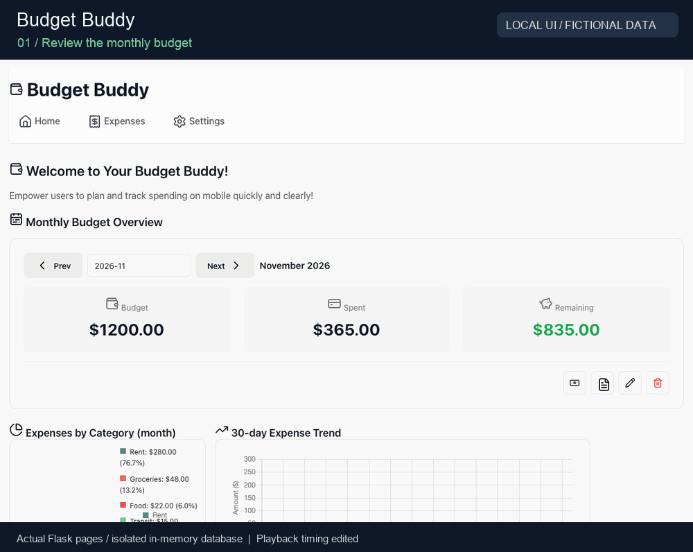

# Budget Buddy · Personal Budget Tracker

**A Flask + MongoDB course project for planning spending, recording expenses and reviewing monthly budgets.**

Personal portfolio copy of [swe-students-fall2025/2-web-app-bytesized](https://github.com/swe-students-fall2025/2-web-app-bytesized), developed by Jasmine Zhu, Athena Luo, Esther / Yuxuan Feng, Zeba Shafi and Harrison. This is a team project; the original repository preserves the course history and collaboration.

This copy starts from a clean source snapshot so historical database credentials are not copied into its Git history. It retains the original [GPL-3.0 license](LICENSE), team attribution and application source. Local-development configuration was updated on 2026-11-20 to use a separate MongoDB container without a shared cloud connection.

## Animated walkthrough

Review the monthly budget → record an expense → filter by category → see the updated total.



Captured from the actual Flask UI using fictional spending records and an isolated in-memory MongoDB substitute. The recorded expense changes the displayed total from 365.00 to 377.50; no personal or team financial data is used.

[Recreate the animation](docs/DEMO.md). Playback timing is edited for readability.

## Product workflow

**Set a monthly budget → plan spending → record actual expenses → filter and review the month.**

| Capability | Implementation |
| --- | --- |
| Planned spending | Create, edit, delete and search planned items |
| Actual expenses | Record dated expenses; edit, delete, search and paginate records |
| Monthly budget | Store monthly limits and query budget, spent and remaining amounts |
| Spending analysis | JSON endpoints for monthly summaries, category breakdowns and daily totals |
| Local persistence | Flask routes and Jinja templates backed by MongoDB collections |

The project demonstrates full-stack CRUD development, data modeling, form-to-database integration and team delivery. The legacy `plans.actual_expense` field stores the planned amount; actual expenses are stored separately in `expenses`.

## Run locally with Docker Compose

Prerequisites: Git and Docker with the Compose plugin.

```bash
git clone https://github.com/yf2685-beep/budget-buddy.git
cd budget-buddy
cp env.example .env
```

Set `SECRET_KEY` in `.env` to a random value (for example, generate one with `python -c "import secrets; print(secrets.token_hex(32))"`), then run:

```bash
docker compose up --build
```

Open **http://localhost:5002**. Compose waits for MongoDB to become healthy and connects the web service to `mongodb://mongodb:27017`. MongoDB is internal to the Compose network; web access is bound to your local machine. No Atlas account or team credentials are required.

```bash
docker compose down
```

Stopping containers preserves the named database volume.

## Source and scope

- [Application routes and data handling](app.py)
- [HTML templates](templates) and [styles](static)
- [Sanitized original course README](docs/course-readme.md) and [course instructions](instructions.md)
- [Original team repository and commit history](https://github.com/swe-students-fall2025/2-web-app-bytesized)

This is a local course prototype with legacy dependencies. It does not implement isolated user accounts; its data is shared within the instance. Some delete routes accept GET requests, and input validation needs further work before deployment. The Docker configuration describes the local demo, not a production service.

## Team

[Jasmine Zhu](https://github.com/jasminezjr) · [Athena Luo](https://github.com/funfig16) · [Esther / Yuxuan Feng](https://github.com/yf2685-beep) · [Zeba Shafi](https://github.com/Zeba-Shafi) · [Harrison](https://github.com/hoc2006-code)

NYU Software Engineering, Fall 2025.
